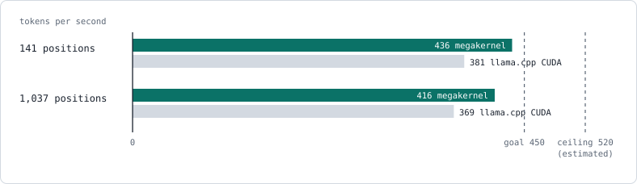
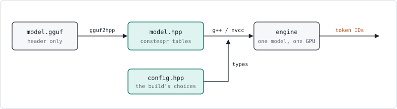
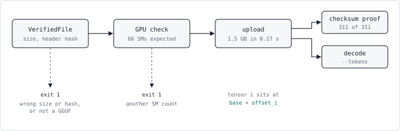
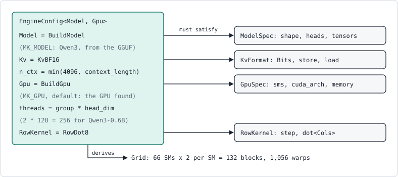
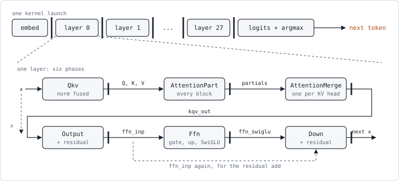
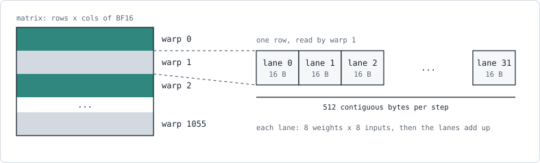
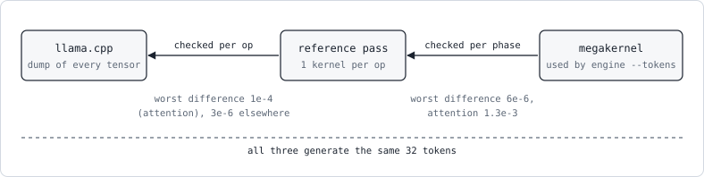
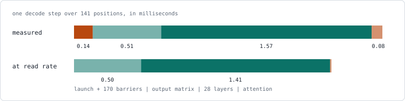

# comptime-megakernel

An LLM inference engine compiled for one model and one GPU. Everything the model or the
build fixes becomes a constant or a type before the program runs: tensor offsets, shapes,
the KV cache format, the GPU's SM count, architecture and memory, and the order in which
the GPU does its work.

First target: decode at batch size 1 of Qwen3-0.6B (BF16) on an RTX 4070 Ti SUPER, checked
against llama.cpp.

<picture>
  <source media="(prefers-color-scheme: dark)" srcset="docs/img/speed-dark.svg">
  
</picture>

| Positions decoded | This engine | llama.cpp, CUDA backend |
|---|---|---|
| 141 | 433 to 440 tokens/s | 381 tokens/s |
| 1,037 | 416 tokens/s | 369 tokens/s |
| 4,013 | 372 tokens/s | not measured |

All numbers are measured on the RTX 4070 Ti SUPER. The ceiling is an estimate: one step
reads 1.19 GB of weights, and a simple kernel on this GPU reads 623 GB/s.

In every diagram below, teal marks what is fixed at compile time and orange marks what
arrives at run time.

## Build and run

```bash
cmake -S . -B build -DMODEL_GGUF=$PWD/models/Qwen_Qwen3-0.6B-bf16.gguf
cmake --build build -j
ctest --test-dir build

# Token IDs in, token IDs out.
build/engine --tokens tests/data/reference/planets/tokens.txt --generate 32
```

The engine takes and prints token IDs. It has no tokenizer yet.

The build is for the RTX 4070 Ti SUPER and compiles CUDA for its architecture alone.
`-DMK_GPU=Rtx5070` builds for the RTX 5070 instead. Another Nvidia GPU is a type in
`src/config/gpu.hpp`, a line in `CMakeLists.txt` and a recompile.

The model is a type too. CMake reads the file's `general.architecture` with the project's
own GGUF reader and names the model type for it, `Qwen3` in `src/arch/qwen3.hpp`. That type
reads every number from `model.hpp`, so another qwen3 model is another `-DMODEL_GGUF` and
nothing else. A model the megakernel cannot run fails to compile with the reason.

## How it works

### 1. The model becomes a header

A build tool, `gguf2hpp`, reads the front of the GGUF file and writes `model.hpp`. That
header holds every tensor's name, shape, dtype and byte offset as `constexpr` tables. The
engine is compiled against it, so a tensor's address is a constant in the kernel.

<picture>
  <source media="(prefers-color-scheme: dark)" srcset="docs/img/pipeline-dark.svg">
  
</picture>

Both inputs to the compiler are fixed before the engine exists. Only token IDs arrive
later.

### 2. Start-up refuses anything it was not built for

The engine maps the file and compares its size and header hash with the constants in
`model.hpp`. Then it compares the GPU's SM count with the GPU type in the configuration.
Only after both checks does it copy the tensor data into one device allocation.

<picture>
  <source media="(prefers-color-scheme: dark)" srcset="docs/img/startup-dark.svg">
  
</picture>

A wrong file or a wrong GPU stops the engine before any weight is uploaded. Without
`--tokens` the engine proves the upload with a checksum per tensor.

### 3. The configuration is a type

One struct names every build choice. It is a template over the model and the GPU, and
each kernel is a template over it, so a choice is a constant inside the kernel and never a
flag. Four of the members are types themselves, and each has a small interface that the
compiler checks. The block size and the context length are derived from the model.

<picture>
  <source media="(prefers-color-scheme: dark)" srcset="docs/img/config-dark.svg">
  
</picture>

To swap a component, name another type in the struct. A grid that cannot run the model
fails a `static_assert` when the kernel is compiled. So do blocks whose shared memory does
not fit on an SM or exceeds a block's 48 KB, a KV cache that does not fit in the GPU's
memory or is longer than the model's context, and device code compiled for another
architecture than the GPU type's.

### 4. The megakernel runs a whole step in one launch

A kernel launch costs more than reading a small matrix, so one launch per operation can
never be fast. The megakernel is launched once per token. All 132 blocks walk the same
list of phases, and a barrier after each phase makes every block wait until all of them
have finished it.

<picture>
  <source media="(prefers-color-scheme: dark)" srcset="docs/img/megakernel-dark.svg">
  
</picture>

A thick bar is a barrier, where all 132 blocks arrive before any continues. The phase
order is a type list. A `static_assert` rejects any order in which a phase reads a buffer
that no earlier phase wrote.

### 5. A matrix is split by a proven schedule

One `constexpr` function gives each of the grid's 1,056 warps a contiguous run of a
matrix's rows. A compile-time check walks every warp and proves that each row has exactly
one. Inside a warp, each of the 32 lanes reads 16 bytes, so the warp reads 512 contiguous
bytes per step.

<picture>
  <source media="(prefers-color-scheme: dark)" srcset="docs/img/row-schedule-dark.svg">
  
</picture>

The split depends only on the row count and the warp count, and both are compile-time
constants.

### 6. Each implementation is checked against the one before it

llama.cpp is the outside reference. A slow reference pass, with one kernel per operation,
is compared with a llama.cpp dump of every tensor. The megakernel is compared with the
reference pass, phase by phase, on the same inputs.

<picture>
  <source media="(prefers-color-scheme: dark)" srcset="docs/img/checks-dark.svg">
  
</picture>

All three generate the same 32 tokens for the test prompt. The megakernel's attention
differs more because K and V are rounded to BF16 on their way into the cache. With a
32-bit cache the difference is 3.7e-6.

### 7. Where a step's time goes

One decode step over 141 positions takes 2.30 ms. The parts were measured by building the
kernel with pieces switched off.

<picture>
  <source media="(prefers-color-scheme: dark)" srcset="docs/img/step-time-dark.svg">
  
</picture>

| Part | Measured | At the memory read rate |
|---|---|---|
| launch, token read-back and all 170 barriers | 0.14 ms | 0 |
| the output matrix (311 MB) | 0.51 ms | 0.50 ms |
| the 28 layers' matrices (881 MB) | 1.57 ms | 1.41 ms |
| attention, at about 70 positions | 0.08 ms | 0.01 ms |

The output matrix already runs at the memory limit. The layers are 11% above it.

## What is still open

| Item | State |
|---|---|
| Another qwen3 model | A model is a type, `Qwen3`, behind the `ModelSpec` concept, and another size is another `-DMODEL_GGUF`. Checked on crafted shapes; no second real model has run. Qwen3-4B does not fit the megakernel's static shared memory. |
| Another model architecture | The decoders are written for the qwen3 graph only. A second architecture is a second model type and a row in CMake's table, plus its own Q/K norm and RoPE. |
| Another GPU | A GPU is one type, named with `-DMK_GPU`. `Rtx5070` compiles for sm_120. It has not been run, and its capacity comes from the specification. |
| KV cache below 16 bits | Would be a new format type. None exists. |
| One launch for many tokens | Still one launch per token. |
| Text in, text out | No tokenizer yet. |

## Where to read more

- `ROADMAP.md`: the targets and the measurements so far.
- `docs/PLAN.md`: how each finished phase was built and proven.
- `CLAUDE.md`: the layout of the repository, the build options and the working rules.
