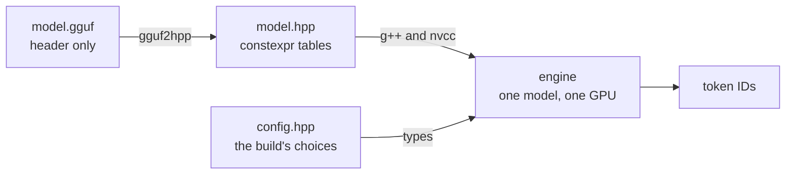
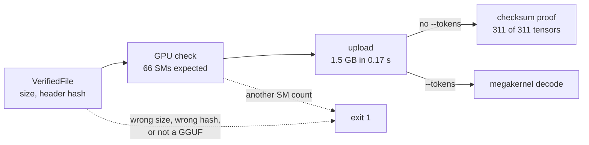
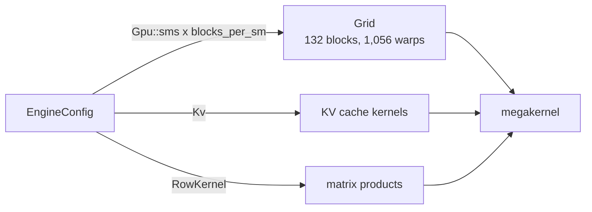
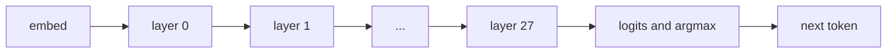
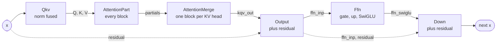
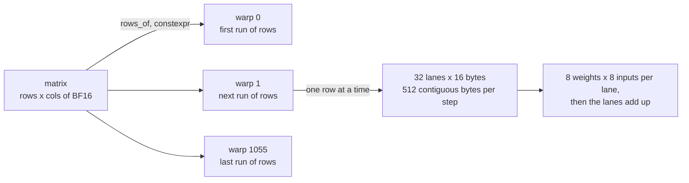
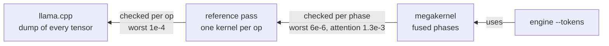

# comptime-megakernel

An LLM inference engine compiled for one model and one GPU. Everything the model or the
build fixes becomes a constant or a type before the program runs: tensor offsets, shapes,
the KV cache format, the GPU's SM count, and the order in which the GPU does its work.

First target: decode at batch size 1 of Qwen3-0.6B (BF16) on an RTX 4070 Ti SUPER, checked
against llama.cpp.

| Positions decoded | This engine | llama.cpp, CUDA backend |
|---|---|---|
| 141 | 433 to 440 tokens/s | 381 tokens/s |
| 1,037 | 416 tokens/s | 369 tokens/s |
| 4,013 | 372 tokens/s | not measured |

All numbers are measured on the RTX 4070 Ti SUPER. The estimated ceiling is about 520
tokens/s: one step reads 1.19 GB of weights, and a simple kernel on this GPU reads
623 GB/s.

## Build and run

```bash
cmake -S . -B build -DMODEL_GGUF=$PWD/models/Qwen_Qwen3-0.6B-bf16.gguf
cmake --build build -j
ctest --test-dir build

# Token IDs in, token IDs out.
build/engine --tokens tests/data/reference/planets/tokens.txt --generate 32
```

The engine takes and prints token IDs. It has no tokenizer yet.

## How it works

### 1. The model becomes a header

A build tool, `gguf2hpp`, reads the front of the GGUF file and writes `model.hpp`. That
header holds every tensor's name, shape, dtype and byte offset as `constexpr` tables. The
engine is compiled against it, so a tensor's address is a constant in the kernel.



Both inputs to the compiler are fixed before the engine exists. Only token IDs arrive
later.

### 2. Start-up refuses anything it was not built for

The engine maps the file and compares its size and header hash with the constants in
`model.hpp`. Then it compares the GPU's SM count with the GPU type in the configuration.
Only after both checks does it copy the tensor data into one device allocation, where
tensor `i` sits at `base + offset_i`.



### 3. The configuration is a type

One struct names every build choice. Each kernel is a template over that struct, so a
choice is a constant inside the kernel and never a flag.

| Member of `EngineConfig` | Value | Interface it must satisfy |
|---|---|---|
| `Kv` | `KvBF16` | `KvFormat`: `Bits`, `store`, `load` |
| `n_ctx` | 4096 | |
| `Gpu` | `Rtx4070TiSuper` | `GpuSpec`: `sms`, `name` |
| `blocks_per_sm` | 2 | |
| `threads` | 256 | |
| `RowKernel` | `RowDot8` | `RowKernel`: `step`, `dot` |



To swap a component, name another type in the struct. A grid that cannot run the model
fails a `static_assert` when the kernel is compiled.

### 4. The megakernel runs a whole step in one launch

A kernel launch costs more than reading a small matrix, so one launch per operation can
never be fast. The megakernel is launched once per token. All 132 blocks walk the same
list of phases, and a barrier after each phase makes every block wait until all of them
have finished it.



One layer is six phases. Each arrow carries the buffer that the next phase reads, and a
barrier sits on every solid arrow.



The phase order is a type list. A `static_assert` rejects any order in which a phase
reads a buffer that no earlier phase wrote.

### 5. A matrix is split by a proven schedule

One `constexpr` function gives each of the grid's 1,056 warps a contiguous run of a
matrix's rows. A compile-time check walks every warp and proves that each row has exactly
one. Inside a warp, each of the 32 lanes reads 16 bytes, so the warp reads 512 contiguous
bytes per step.



### 6. Each implementation is checked against the one before it

llama.cpp is the outside reference. A slow reference pass, with one kernel per operation,
is compared with a llama.cpp dump of every tensor. The megakernel is compared with the
reference pass, phase by phase, on the same inputs.



All three generate the same 32 tokens for the test prompt. The megakernel's attention
differs more because K and V are rounded to BF16 on their way into the cache. With a
32-bit cache the difference is 3.7e-6.

### 7. Where a step's time goes

One decode step over 141 positions takes 2.30 ms. The parts were measured by building the
kernel with pieces switched off.

| Part | Measured | At the memory read rate |
|---|---|---|
| launch, token read-back and all 170 barriers | 0.14 ms | 0 |
| the output matrix (311 MB) | 0.51 ms | 0.50 ms |
| the 28 layers' matrices (881 MB) | 1.57 ms | 1.41 ms |
| attention, at about 70 positions | 0.08 ms | 0.01 ms |

The output matrix already runs at the memory limit. The layers are 11% above it.

## What is still open

| Item | State |
|---|---|
| Another model architecture | The forward pass is written for the qwen3 graph only. |
| Another GPU | A GPU is one type. A 48-SM type compiles. It has not been run. |
| KV cache below 16 bits | Would be a new format type. None exists. |
| One launch for many tokens | Still one launch per token. |
| Text in, text out | No tokenizer yet. |

## Where to read more

- `ROADMAP.md`: the targets and the measurements so far.
- `docs/PLAN.md`: how each finished phase was built and proven.
- `CLAUDE.md`: the layout of the repository, the build options and the working rules.
